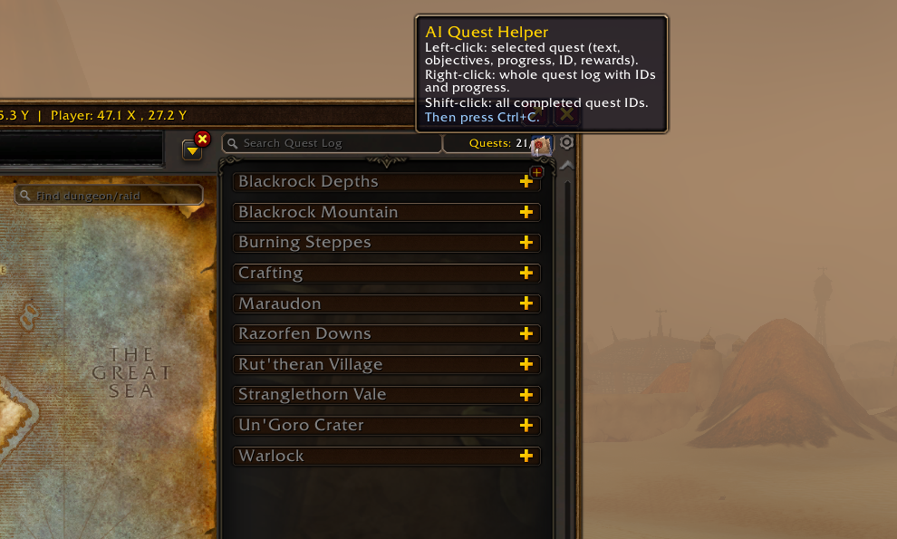
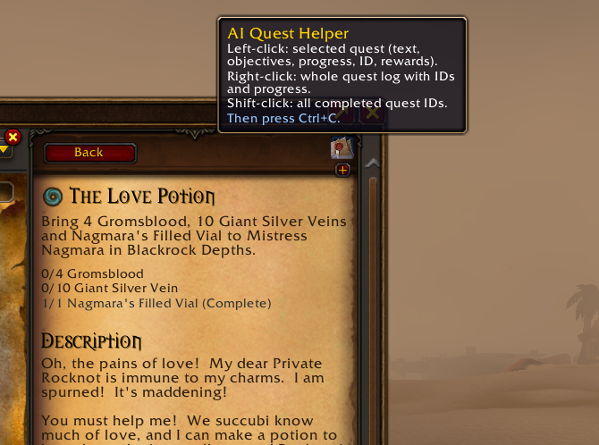
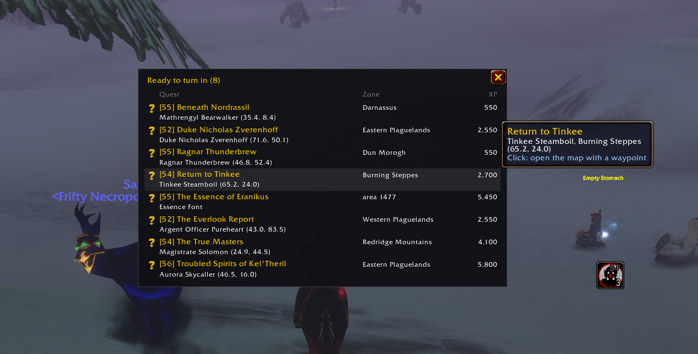
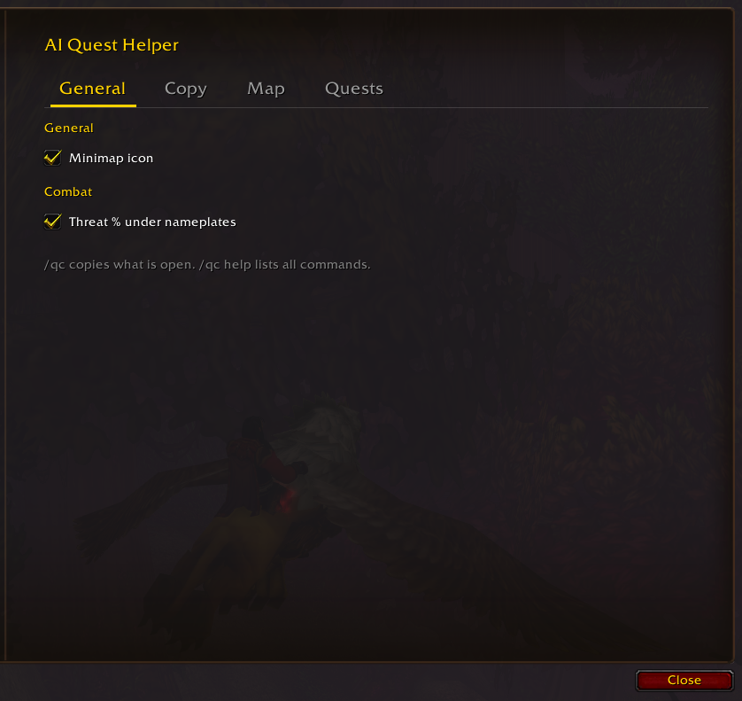

# AI Quest Helper

A World of Warcraft: Forever (Classic+) addon that turns what is on your screen into clean, AI-friendly text. Click the small note icon, press Ctrl+C, and paste the quest, dialog, bags or gear into any AI assistant for help.

## Important: install Questie

AI Quest Helper works best together with **Questie**. Questie provides where quest mobs, items and objects are, who gives and takes each quest, and the quest chain. Without Questie you still get the quest text, bags, gear and dialog, but no quest locations, so the quest arrow and the target button only know what you have seen yourself.

## Screenshots

## Features

**Copy to clipboard**
- Quest export from the quest map or quest log: title, ID, level, objectives with progress, description, rewards, your position and zone level range.
- Questie data when Questie is installed: quest giver, turn-in, where to kill, loot or use objectives, previous and next quest.
- Bag contents split into items for this quest, other quest items and everything else.
- Quest and NPC dialog, gossip, books and notes (all pages you have turned).
- Equipped gear with item level, stats, enchants, gems, Equip/Use lines and durability.
- Every export starts with a short instruction block so the AI answers in one compact block per quest.

**Learning**
- Remembers where you loot quest items and where quest mobs die, for zones Questie does not cover.

**Quest helpers**
- Arrow to the nearest unfinished quest objective.
- Target button: left click targets your quest mobs, right click your group's.
- Popup with quests ready to turn in: who, zone and XP. Click a quest to open the map with a waypoint.
- One button to collapse or expand every header in the quest log.

**Map and combat**
- Zone level ranges, dungeon and raid entrances and a dungeon search box on the world map.
- Threat % next to the level on enemy nameplates.

## Commands

| Command | What it does |
|---|---|
| `/qc` or `/aqh` | Copy what is open (quest, dialog, book) |
| `/qc quest` | Selected quest |
| `/qc quests` | Whole quest log |
| `/qc bags` | Bags (`/qc ids` for item IDs only) |
| `/qc gear` | Equipped gear |
| `/qc done` | Completed quest IDs |
| `/qc ready` | Quests ready to turn in |
| `/qc config` | Settings (Options, AddOns, AI Quest Helper) |
| `/qc save` | Save a snapshot and reload |

Keybindings for copy, bags, gear and the target button are under Key Bindings, AddOns.

## Install

Install from CurseForge, or copy the `AIQuestHelper` folder into `World of Warcraft/_forever_/Interface/AddOns/`.

## Credits

- Zone and instance data adapted from [Extended Map Info](https://www.curseforge.com/wow/addons/extended-map-info) by Goose__ (LGPL-2.1, see `AIQuestHelper/Data/LICENSE`).
- LibStub, CallbackHandler-1.0, LibDataBroker-1.1 and LibDBIcon-1.0 are included under their own licenses.
- Questie is optional and used at runtime only.

## License

MIT for the addon code, see `LICENSE`. The files in `AIQuestHelper/Data` and `AIQuestHelper/Libs` keep their original licenses.
